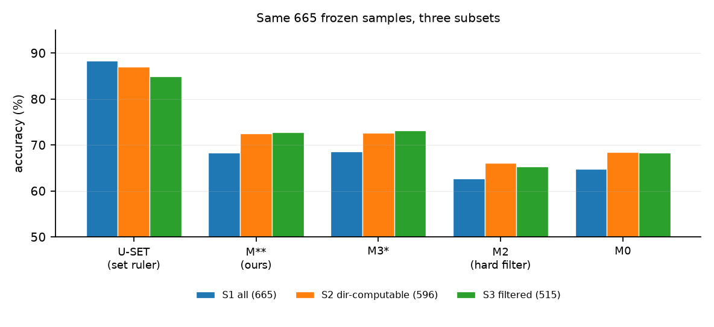
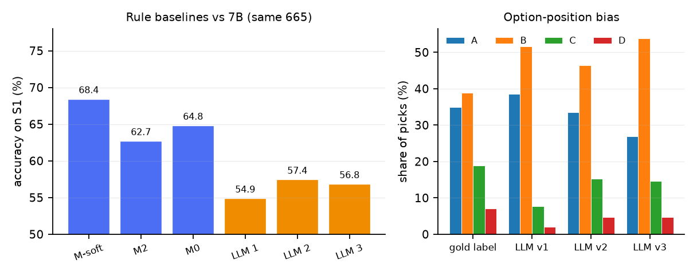

# Spatial Locative Reference Resolution on ALFRED

**English** | [中文版](README.zh.md)

Reproducibility package for the course project **"How much does a spatial description
actually constrain? Two rulers for grounded instruction following."**

Given an instruction such as *"Pick up the pen that is on the left side of the
dresser"* and a scene with 2–7 interchangeable pens, the task is to decide **which pen**
the instruction refers to. This repository contains the frozen sample table, the
geometry-based reference implementation, every baseline, the 7B learning baseline, and
the scripts that regenerate all reported tables and figures.

**Reproduce everything in two commands (CPU only, ~10 s):**

```bash
pip install -r requirements.txt
bash scripts/run_all.sh
```

---

## 1. Research question

Spatial locative expressions ("the cup to the left of the sink") are usually evaluated
as a single accuracy number. That conflates two different questions:

1. **Does the description constrain the scene at all?** — i.e. is the human annotation
   even inside the region the words describe?
2. **Can a method pick exactly one object?** — because a robot has to grasp one cup.

We measure (1) with a set-valued ruler (**U-SET**) and (2) with a single-point selector
(`M-soft`), and show that the gap between them is a property of the *data*, not a
failure of the method.

## 2. Reported results

665 scorable samples, 2.8 candidates on average, all differences are paired
(McNemar exact test, 4,000 bootstrap resamples for CIs).

| Subset | n | U-SET (set ruler) | **M-soft** (ours) | M2 hard filter | M0 nearest | 7B (best prompt) | random in pool |
|---|---:|---:|---:|---:|---:|---:|---:|
| S1 all scorable | 665 | **88.4%** | **68.4%** | 62.7% | 64.8% | 57.4% | 38.3% |
| S2 direction computable | 596 | 87.1% | **72.5%** | 66.1% | 68.5% | 61.1% | — |
| S3 only truly filtered | 515 | 85.0% | **72.8%** | 65.4% | 68.3% | 61.6% | — |

Three findings:

1. **Direction must be a prior, not a veto.** Hard-filtering the "wrong" side drops
   accuracy from 68.4% to 62.7% (p < 0.0001) because **157 of 665** human annotations
   sit on the side opposite to the words.
2. **The distance rule is hardly ever tested.** "Take the nearest" fires on **4 of 665**
   samples (0.6%); ALFRED annotators almost never write "nearest". Distance is our
   geometric prior, not a linguistic constraint.
3. **A 7B LLM keeps the direction but cannot rank inside it.** Qwen2.5-7B-Instruct picks
   an object inside the allowed half-plane **98.6%** of the time (higher than the
   annotations' own 88.4%), yet reaches only 57.4% overall — worse than a one-line
   "nearest" rule. Three prompt variants do not differ significantly (p = 0.22, p = 0.68).




## 3. Repository structure

```
spatial-locative-repro/
├── README.md                  this file
├── README.zh.md               Chinese translation of this file
├── requirements.txt           core dependencies (CPU)
├── requirements-llm.txt       only needed to re-run 7B inference (GPU)
├── LICENSE                    MIT (our code) + attribution of third-party assets
├── AI_DISCLOSURE.md           what an AI assistant helped with
├── AI_DISCLOSURE.zh.md        Chinese translation
├── configs/
│   ├── main.yaml              weights, subsets, bootstrap settings
│   └── llm_7b.yaml            model, decoding, prompts, hardware
├── data/
│   ├── README.md              provenance, band construction, integrity check
│   ├── clean_spatial_ext.csv  frozen samples (1,392 rows, 665 scorable)
│   ├── DATA_LOCK.json         sha256 of every frozen asset
│   ├── llm_prompts.jsonl      665 samples × 3 prompt variants
│   └── derived/               loc_candidates.json.gz, loc_anchors.json.gz
├── src/
│   ├── _paths.py              all path resolution (no absolute paths anywhere)
│   ├── scoring.py             geometry + cascade scoring  → results/cascade_detail.csv
│   ├── evaluate.py            tables T1–T12 + 5 figures   → results/, figures/
│   ├── selection.py           the proposed selector (soft prior w=0.2 + distance layer)
│   ├── baselines.py           control suite + weight sweep + cross-validation
│   ├── text_baseline.py       TF-IDF text baseline and its tokeniser/synonyms
│   ├── build_dataset.py       data prep from the raw ALFRED release (optional)
│   ├── build_anchors.py       anchor extraction (optional)
│   ├── extend_dataset.py      adds bands D0/D1/D2/D2R (optional)
│   ├── audit_data.py          final consistency audit (optional)
│   ├── inference_llm.py       7B inference, HF backend (GPU; predictions included)
│   └── synonyms.py           33-entry synonym table (single source of truth)
├── scripts/
│   ├── run_all.sh             the main experiment, end to end
│   └── run_llm_7b.sh          the 7B baseline
├── results/                   every table in the paper (regenerated by run_all.sh)
└── figures/                   the five figures in the paper
```

## 4. Hardware

| Component | Requirement |
|---|---|
| Main experiment (`scripts/run_all.sh`) | any CPU, < 1 GB RAM, ~10 s |
| 7B baseline (`scripts/run_llm_7b.sh`) | 1 × NVIDIA RTX A5000 (24 GB), ~15.2 GB peak |
| Disk | ~10 MB for the repo, ~36 GB if you also download the raw ALFRED release |

The reported 7B numbers were produced on the course-provided **RTX A5000 (24 GB)**,
`bfloat16`, greedy decoding, batch size 8.

## 5. Software

Tested with Python 3.15.0 on Windows and Linux.

```
numpy==2.5.4
pandas==3.0.6
scikit-learn==1.9.1
matplotlib==3.11.2
```

The LLM stack (`requirements-llm.txt`) is only needed to regenerate the predictions:
`torch==2.14.1`, `transformers==5.24.0`, `accelerate==1.11.0`, `bitsandbytes==0.48.0`
(CUDA 13.0 in the reported run).

## 6. Installation

```bash
git clone https://github.com/<your-username>/spatial-locative-repro.git
cd spatial-locative-repro
python -m venv .venv && source .venv/bin/activate    # Windows: .venv\Scripts\activate
pip install -r requirements.txt
```

## 7. Dataset

All experiments use a **derived** subset of **ALFRED** (Shridhar et al., CVPR 2020,
MIT License, https://github.com/askforalfred/alfred). The frozen sample table is
included, so no download is required to reproduce the paper; the 36 GB raw release is
only needed to rebuild the table from scratch.

Details — band construction, geometry definitions, integrity hashes, regeneration
commands — are in [`data/README.md`](data/README.md). Summary:

* 1,392 rows, of which `Scorable == 1` gives **665** samples.
* 523 exact object anchors, 73 scene-level anchors, 69 with no anchor (text fallback).
* Excluded: 225 single-candidate pools (nothing to choose) and 502 samples whose anchor
  is absent from the scene graph.
* Three precomputed columns drive everything: `Side_Cos` (which half-plane the candidate
  is on), `D_Target` (distance **to the anchor**), `Label_In_Side` (whether the human
  annotation itself obeys the words).

## 8. Method in five lines

```python
# for each candidate of the target category
side = cos(robot -> anchor, anchor -> candidate)       # > 0  => named side
dist = ||candidate - anchor||                          # metres, x-z plane
score = dist * (1 - 0.2 * sign_positive(side))         # soft prior, w = 0.2
pick  = argmin(score)                                  # ties -> higher side score
# the distance layer becomes a hard filter only when the instruction says "nearest"
```

`src/selection.py` implements this; `configs/main.yaml` records the constants.

## 9. Training

**There is no training step.** The proposed method is a deterministic scoring function
with one hyper-parameter (`direction_weight = 0.2`), selected on a 5-fold
out-of-fold sweep in `src/baselines.py`; the same value is optimal in every fold. The
7B model is used zero-shot — no fine-tuning, no adapter.

We state this explicitly rather than shipping a placeholder `train.py`: the contribution
is a measurement protocol plus a rule, and any trained component would be a different
claim.

## 10. Evaluation

```bash
bash scripts/run_all.sh
# or, step by step
python src/scoring.py      # cascade scoring  -> results/cascade_detail.csv
python src/evaluate.py     # all tables + 5 figures
python src/evaluate.py --no-fig    # skip plotting
```

`src/evaluate.py` writes one CSV per table plus `results/PAPER_EXPERIMENTS.md` (the full
table-by-table report, in the author's working language, Chinese).

| File | Content |
|---|---|
| `paper_T1_main.csv` | the main table: 3 subsets × 19 methods |
| `paper_T2/T3/T4` | difficulty bands, relation types, allowed-set size |
| `paper_T5_audit.csv` | annotation audit: 439 self-consistent vs 157 contradictory |
| `paper_T6_ruler.csv`, `paper_T6b_quadrant.csv` | the two rulers and the 2×2 bridge between them |
| `paper_T7_ablation.csv` | soft prior vs hard filter vs no direction layer |
| `paper_T8/T8b` | evolution of the pipeline; two-stage (category × instance) decomposition |
| `paper_T9_failures.csv` | where the remaining errors come from |
| `paper_T10/T11` | weight sweep; paired significance tests |
| `paper_T12a–d` | 7B baseline: tests, behaviour diagnosis, strata, position bias |
| `paper_detail.csv` | per-sample trace for all 665 samples |

## 11. Expected results

After `bash scripts/run_all.sh`, `results/paper_T1_main.csv` must contain:

| Method | S1 (665) | S2 (596) | S3 (515) |
|---|---:|---:|---:|
| U-SET (set ruler) | 88.4 | 87.1 | 85.0 |
| M-soft (ours) | 68.4 | 72.5 | 72.8 |
| M2 hard filter | 62.7 | 66.1 | 65.4 |
| M0 nearest | 64.8 | 68.5 | 68.3 |
| LLM 7B · v2 | 57.4 | 61.1 | 61.6 |

If any of these differs, the frozen data was modified — check it with the sha256
snippet in `data/README.md`.

## 12. The 7B baseline: results, and re-running it

**The 7B numbers are final and already in the tables** — row `LLM 7B · v2` of
`paper_T1_main.csv` and the four diagnostics in `paper_T12a–d`: Qwen2.5-7B-Instruct,
1,995 greedy generations (665 samples × 3 prompt variants) on one A5000. Nothing in
this section is needed to reproduce the reported results; it only regenerates the
predictions.

```bash
pip install -r requirements-llm.txt
bash scripts/run_llm_7b.sh          # writes results/llm_predictions.jsonl
bash scripts/run_all.sh             # merges the predictions into T1 and T12
```

* Model: `Qwen/Qwen2.5-7B-Instruct` (Apache-2.0), 15.2 GB in bf16.
* Predictions from the reported run are already committed, so **the tables reproduce
  without a GPU**; only re-generating them needs the A5000.
* Three prompt variants: raw numbers, verbalised relations, verbalised + explicit
  two-step rule.

## 13. Limitations

* One dataset (ALFRED) and one LLM (Qwen2.5-7B, single greedy run, no CoT, no
  self-consistency). The LLM result is a negative baseline for *this* model, not a
  claim about LLMs in general.
* 68.4% is a **given-category** number: it does not solve "is the object a pen".
  End-to-end (text predicts the category, geometry picks the instance) is 38.9%.
* No closed-loop rollout in AI2-THOR; the metric is "chose the right object", not task
  success.
* Method names in the CSV files are Chinese (the author's working language); see the
  mapping in `results/README.md`.

## 14. Citation and attribution

If you use this code or the derived tables:

```bibtex
@misc{wang2026spatiallocative,
  author = {Wang, Xinrui},
  title  = {How much does a spatial description constrain? Two rulers for grounded
            instruction following},
  year   = {2026},
  note   = {Course project, reproducibility package}
}
```

Third-party assets, all attributed in `LICENSE`:

* **ALFRED** — Shridhar et al., CVPR 2020, MIT License.
* **Qwen2.5-7B-Instruct** — Apache-2.0.
* scikit-learn, pandas, numpy, matplotlib — used as libraries, no code copied.

## 15. AI use

An AI coding assistant was used for refactoring, documentation and debugging; it did
not design the method or produce any number. See [`AI_DISCLOSURE.md`](AI_DISCLOSURE.md)
(Chinese: [`AI_DISCLOSURE.zh.md`](AI_DISCLOSURE.zh.md)).

## 16. License

MIT for the code and the derived tables. The ALFRED raw release and images are **not**
redistributed here.
