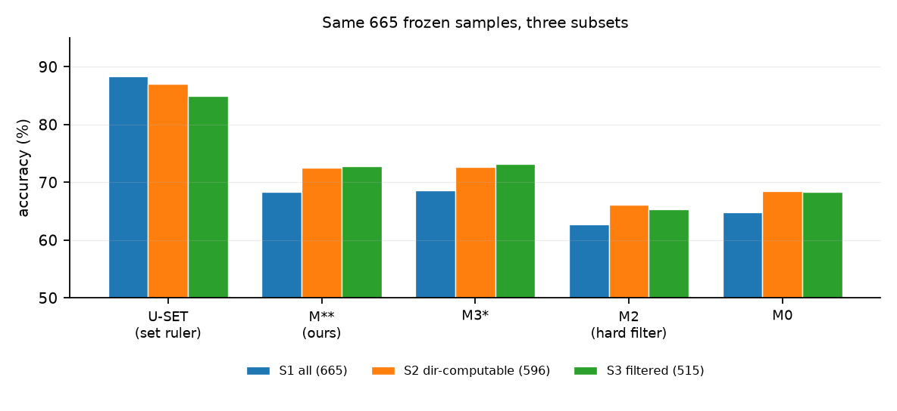
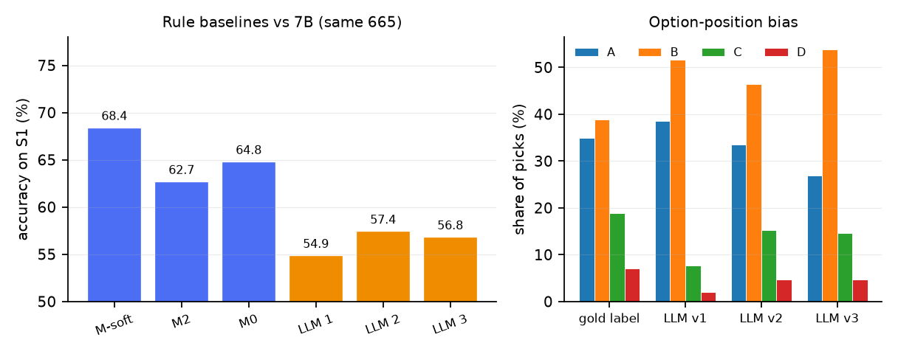

# ALFRED 上的空间方位指称消解

课程项目 **「空间描述到底约束了多少？面向落地指令跟随的两把尺子」** 的复现包。

给一句指令——比如 *"Pick up the pen that is on the left side of the dresser"*（把梳妆台左边的笔拿起来）——场景里有 2~7 支长得一样的笔，任务是判断这句话指的是**哪一支**。本仓库包含冻结样本表、基于几何的参考实现、全部基线、7B 学习基线，以及能重新生成所有表格和图片的脚本。

**两条命令复现全部结果（只用 CPU，约 10 秒）：**

```bash
pip install -r requirements.txt
bash scripts/run_all.sh
```

---

## 1. 研究问题

空间方位表达（"水槽左边的杯子"）通常被压缩成一个准确率数字来评价。这把两个不同的问题混在了一起：

1. **这句话对场景有没有约束？** —— 也就是人类标注本身，是否落在题面所描述的那片区域内。
2. **方法能不能只挑出一个物体？** —— 因为机器人必须抓走某一个杯子。

我们用一把集合口径的尺子（**U-SET**）测第 (1) 件事，用一个单点选择器（`M-soft`）测第 (2) 件事，并说明两者的差距是**数据**的性质，而不是方法失败。

## 2. 主要结果

665 条可判分样本，平均每个样本 2.8 个候选；所有对比都是配对的（McNemar 精确检验，置信区间用 4,000 次 bootstrap）。

| 子集 | n | U-SET（集合口径） | **M-soft（本文）** | M2 硬筛 | M0 取最近 | 7B（最好提示） | 全池随机 |
|---|---:|---:|---:|---:|---:|---:|---:|
| S1 全量 | 665 | **88.4%** | **68.4%** | 62.7% | 64.8% | 57.4% | 38.3% |
| S2 方向可算 | 596 | 87.1% | **72.5%** | 66.1% | 68.5% | 61.1% | — |
| S3 真被筛过 | 515 | 85.0% | **72.8%** | 65.4% | 68.3% | 61.6% | — |

三个发现：

1. **方向只能当先验，不能当否决权。** 把"反侧"硬排除，准确率从 68.4% 掉到 62.7%（p < 0.0001），因为 **665 条里有 157 条**人类标注本身就落在题面说的反侧。
2. **距离规则几乎没被考到。** "取最近"这条规则只在 **665 条中的 4 条**（0.6%）上生效；ALFRED 的标注者几乎不写 "nearest"。距离是我们自己算的几何先验，不是题面约束。
3. **7B 模型守住了方向，却不会在方向内排序。** Qwen2.5-7B-Instruct 有 **98.6%** 的选择落在题面允许的半平面内（比标注自己的 88.4% 还高），但总准确率只有 57.4%——低于一行代码的"取最近"。三套提示之间没有显著差异（p = 0.22，p = 0.68）。




## 3. 仓库结构

```
spatial-locative-repro/
├── README.md                  英文说明（本页是中文版 README.zh.md）
├── requirements.txt           核心依赖（CPU）
├── requirements-llm.txt       可选，只有重跑 7B 才需要
├── LICENSE                    MIT（我们的代码）+ 第三方资产归属
├── AI_DISCLOSURE.md           AI 助手参与的部分
├── configs/
│   ├── main.yaml              权重、子集定义、bootstrap 设置
│   └── llm_7b.yaml            模型、解码参数、提示、硬件
├── data/
│   ├── README.md              数据来源、分层构建、完整性校验
│   ├── clean_spatial_ext.csv  冻结样本（1,392 行，665 条可判分）
│   ├── DATA_LOCK.json         每个冻结资产的 sha256
│   ├── llm_prompts.jsonl      665 条 × 3 套提示
│   └── derived/               loc_candidates.json.gz、loc_anchors.json.gz
├── src/
│   ├── _paths.py              统一路径解析（全库无绝对路径）
│   ├── scoring.py             几何 + 级联打分 → results/cascade_detail.csv
│   ├── evaluate.py            T1–T12 表格 + 5 张图 → results/、figures/
│   ├── selection.py           本文的选择器（软先验 w=0.2 + 距离层）
│   ├── baselines.py           对照组 + 权重扫描 + 交叉验证
│   ├── text_baseline.py       TF-IDF 文本基线及其分词/同义词表
│   ├── build_dataset.py       从 ALFRED 原始发布构建数据（可选）
│   ├── build_anchors.py       锚点提取（可选）
│   ├── extend_dataset.py      补上 D0/D1/D2/D2R 分层（可选）
│   ├── audit_data.py          最终一致性审计（可选）
│   ├── inference_llm.py       7B 推理，HF 后端（可选，需 GPU）
│   └── synonyms.py            33 条同义词表（单一真源）
├── scripts/
│   ├── run_all.sh             主实验，一条命令跑到底
│   └── run_llm_7b.sh          7B 基线
├── results/                   论文里的每一张表（由 run_all.sh 重生成）
└── figures/                   论文里的五张图
```

## 4. 硬件

| 部分 | 要求 |
|---|---|
| 主实验（`scripts/run_all.sh`） | 任意 CPU，内存 < 1 GB，约 10 秒 |
| 7B 基线（`scripts/run_llm_7b.sh`） | 1 张 NVIDIA RTX A5000（24 GB），峰值约 15.2 GB |
| 磁盘 | 仓库约 10 MB；若另外下载 ALFRED 原始数据约 36 GB |

报告中的 7B 数字在课程提供的 **RTX A5000（24 GB）** 上产出，`bfloat16`，贪心解码，batch size 8。

## 5. 软件环境

在 Windows 和 Linux 上以 Python 3.15.0 测试通过。

```
numpy==2.5.4
pandas==3.0.6
scikit-learn==1.9.1
matplotlib==3.11.2
```

可选的 LLM 依赖（`requirements-llm.txt`）为
`torch==2.14.1`、`transformers==5.24.0`、`accelerate==1.11.0`、`bitsandbytes==0.48.0`
（实测环境为 CUDA 13.0）。

## 6. 安装

```bash
git clone https://github.com/<your-username>/spatial-locative-repro.git
cd spatial-locative-repro
python -m venv .venv && source .venv/bin/activate    # Windows 用 .venv\Scripts\activate
pip install -r requirements.txt
```

## 7. 数据集

所有实验都基于 **ALFRED** 的派生数据子集（Shridhar 等，CVPR 2020，MIT License，https://github.com/askforalfred/alfred）。冻结样本表已经随仓库提供，**复现论文不需要下载任何数据**；只有在从零重建这张表时才需要 36 GB 的原始发布。

分层构建方式、几何量定义、完整性哈希、重建命令等细节见 [`data/README.md`](data/README.md)。摘要：

* 全表 1,392 行，其中 `Scorable == 1` 的 **665** 条进入实验。
* 523 条为精确物体锚点，73 条为场景级锚点，69 条无锚点（走文本兜底）。
* 排除：225 条池里只有一个候选（无从选择），502 条锚点不在场景图中。
* 三列预计算量驱动一切：`Side_Cos`（候选落在哪个半平面）、`D_Target`（**到锚点**的距离）、`Label_In_Side`（人类标注本身是否遵守题面方位）。

## 8. 方法（五行代码）

```python
# 对目标类别的每个候选
side = cos(robot -> anchor, anchor -> candidate)       # > 0 表示位于题面所说的那一侧
dist = ||candidate - anchor||                          # 米，x-z 平面
score = dist * (1 - 0.2 * sign_positive(side))         # 软先验，w = 0.2
pick  = argmin(score)                                  # 并列时取方位分更高者
# 只有当题面明确写了 "nearest" 时，距离层才变成硬筛
```

实现在 `src/selection.py`，常数记录在 `configs/main.yaml`。

## 9. 训练

**本项目没有训练步骤。** 本文方法是确定性打分函数，只有一个超参（`direction_weight = 0.2`），由 `src/baselines.py` 的 5 折 out-of-fold 扫描选出，每一折的最优值都相同。7B 模型是零样本使用——不微调、不加 adapter。

我们选择明说这件事，而不是塞一个占位的 `train.py`：本文的贡献是"一套测量协议 + 一条规则"，任何"被训练出来的组件"都会变成另一个主张。

## 10. 评测

```bash
bash scripts/run_all.sh
# 或者分步执行
python src/scoring.py      # 级联打分 → results/cascade_detail.csv
python src/evaluate.py     # 全部表格 + 5 张图
python src/evaluate.py --no-fig    # 跳过画图
```

`src/evaluate.py` 为每张表写一个 CSV，并生成 `results/PAPER_EXPERIMENTS.md`（逐表解读的完整报告，中文）。

| 文件 | 内容 |
|---|---|
| `paper_T1_main.csv` | 主表：3 个子集 × 19 种方法 |
| `paper_T2/T3/T4` | 难度分层、关系类型、允许集大小 |
| `paper_T5_audit.csv` | 标注审计：439 条自洽 vs 157 条矛盾 |
| `paper_T6_ruler.csv`、`paper_T6b_quadrant.csv` | 两把尺子及它们之间的 2×2 桥接 |
| `paper_T7_ablation.csv` | 软先验 vs 硬筛 vs 去掉方向层 |
| `paper_T8/T8b` | 管线演进；两段式（类别 × 实例）分解 |
| `paper_T9_failures.csv` | 剩余失分来自哪个环节 |
| `paper_T10/T11` | 权重扫描；配对显著性检验 |
| `paper_T12a–d` | 7B 基线：检验、行为诊断、分层、位置偏置 |
| `paper_detail.csv` | 665 条逐样本轨迹 |

## 11. 预期结果

执行 `bash scripts/run_all.sh` 后，`results/paper_T1_main.csv` 必须包含：

| 方法 | S1 (665) | S2 (596) | S3 (515) |
|---|---:|---:|---:|
| U-SET（集合口径） | 88.4 | 87.1 | 85.0 |
| M-soft（本文） | 68.4 | 72.5 | 72.8 |
| M2 硬筛 | 62.7 | 66.1 | 65.4 |
| M0 取最近 | 64.8 | 68.5 | 68.3 |
| LLM 7B · v2 | 57.4 | 61.1 | 61.6 |

只要有任何一个对不上，说明冻结数据被改过——用 `data/README.md` 里的 sha256 片段核对。

## 12. 重跑 7B 基线（可选）

```bash
pip install -r requirements-llm.txt
bash scripts/run_llm_7b.sh          # 写出 results/llm_predictions.jsonl
bash scripts/run_all.sh             # 把预测并进 T1 和 T12
```

* 模型：`Qwen/Qwen2.5-7B-Instruct`（Apache-2.0），bf16 下 15.2 GB。
* 报告所用的预测**已经提交在仓库里**，所以**复现表格不需要 GPU**；只有重新生成预测才需要 A5000。
* 三套提示：原始数字、把关系说成人话、说成人话 + 明写两步规则。

## 13. 限制

* 只有一个数据集（ALFRED）、一个 LLM（Qwen2.5-7B，单次贪心，无 CoT、无 self-consistency）。LLM 那条是**针对这个模型**的负结果，不能推广成"LLM 都不会空间推理"。
* 68.4% 是**给定类别**的口径：它不解决"要拿的是不是笔"。端到端（文本先定类别、几何再选实例）是 38.9%。
* 没有 AI2-THOR 闭环 rollout；指标是"选对了物体"，不是任务成功率。
* CSV 里的方法名是中文（作者的工作语言），对照表见 `results/README.md`。

## 14. 引用与第三方归属

如果用到这份代码或派生表格：

```bibtex
@misc{wang2026spatiallocative,
  author = {Wang, Xinrui},
  title  = {How much does a spatial description constrain? Two rulers for grounded
            instruction following},
  year   = {2026},
  note   = {Course project, reproducibility package}
}
```

第三方资产（均在 `LICENSE` 中注明）：

* **ALFRED** —— Shridhar 等，CVPR 2020，MIT License。
* **Qwen2.5-7B-Instruct** —— Apache-2.0。
* scikit-learn、pandas、numpy、matplotlib —— 仅作为库调用，未复制其代码。

## 15. AI 使用

使用了 AI 编程助手做重构、文档和调试；它没有设计方法，也没有产生任何数字。详见 [`AI_DISCLOSURE.md`](AI_DISCLOSURE.md) 与 [`AI_DISCLOSURE.zh.md`](AI_DISCLOSURE.zh.md)。

## 16. 许可

代码与派生表格采用 MIT。ALFRED 的原始发布与图像**不**在本仓库中再分发。
